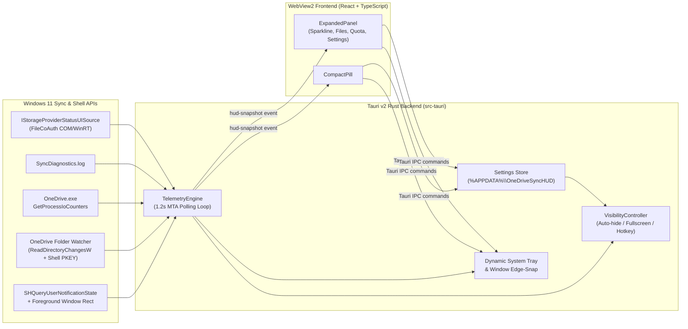

# OneDrive Sync HUD

A lightweight, always-on-top **Windows 11 Fluent Glass** overlay that monitors Microsoft OneDrive synchronization progress, live transfer speeds, recent file activity, and cloud storage quota without cluttering your desktop.

[](https://github.com/nawawwow/onedrive-sync-hud/actions/workflows/ci.yml)
[](https://github.com/nawawwow/onedrive-sync-hud/releases)
[](LICENSE)
[](#prerequisites)
[](https://v2.tauri.app/)

---

## Features

- **Compact Floating Pill → Adaptive Detail Card**: Unobtrusive always-on-top capsule showing live status, determinate/indeterminate progress bar, and percentage or speed. Click to expand upward (when anchored near the bottom) or downward (when near the top).
- **Smart Auto-Hide & Fullscreen Awareness**:
  - Automatically surfaces during active sync, paused states, offline events, or sync errors.
  - Fades away automatically after a configurable idle delay (default `6s`) once OneDrive is **Up to date**, while remaining visible on errors/paused states until resolved or dismissed.
  - Automatically hides during fullscreen games, videos, and presentations (`SHQueryUserNotificationState` + foreground monitor verification).
- **Native Windows 11 Multi-Source Telemetry**:
  - **Windows `IStorageProviderStatusUISourceFactory`**: Persistent COM/WinRT session for real-time sync state, localized status summaries, cloud storage quota, and official OneDrive provider commands.
  - **`SyncDiagnostics.log` Counter Parser**: Reads upload/download file counts, transferred bytes, ETA, error/conflict counters, and stall flags with freshness gating.
  - **Live Process I/O Meter**: Samples `OneDrive.exe` throughput with EMA smoothing to drive a 30-sample mini sparkline.
  - **Real-Time File Activity Watcher**: Uses `ReadDirectoryChangesW` (`notify`) and Shell `PKEY_StorageProviderState` to list active/recently synced files with 1-click **Reveal in Explorer**.
- **Multi-Account Support**: Automatically discovers all registered OneDrive Personal and Work/School accounts (`SyncRootManager` & `HKCU\Software\Microsoft\OneDrive\Accounts`), staying clean for single-account setups and showing per-account tabs when multiple accounts exist.
- **System Tray, Global Shortcut & Persistence**:
  - Dynamic System Tray icon reflecting live sync state, paired with quick settings.
  - Global hotkey **`Ctrl+Alt+O`** to show or hide the overlay anytime.
  - Free dragging with multi-monitor work-area edge snapping, position lock, adjustable opacity (`70%–100%`), Windows Light/Dark auto-theme (plus manual override), and optional **Start with Windows**.

---

## Architecture



### Project Structure

```text
onedrive-sync-hud/
├── .github/workflows/       # Windows CI (test/lint) and tag-triggered Release pipeline
├── src/                     # React + TypeScript Fluent Glass frontend
│   ├── components/          # CompactPill, ExpandedPanel, SpeedSparkline, Icons
│   ├── styles/fluent.css    # Windows 11 Fluent Light/Dark glass tokens
│   └── utils/               # Byte/speed/ETA formatting utilities + Vitest specs
├── src-tauri/               # Tauri v2 Rust native backend
│   ├── capabilities/        # Tauri v2 window & global-shortcut capabilities
│   ├── icons/               # High-DPI PNG & multi-resolution Windows ICO
│   └── src/
│       ├── onedrive/        # Accounts, StatusUI COM, diagnostics, throughput, watcher, fullscreen
│       ├── settings.rs      # JSON persistence & Windows Run startup integration
│       ├── tray.rs          # Dynamic RGBA tray icons & context menu
│       └── window_ctrl.rs   # Edge snapping, multi-monitor clamping, directional anchor resize
├── CHANGELOG.md
└── LICENSE
```

---

## Prerequisites

- **OS**: Windows 11 (64-bit) with **Microsoft Edge WebView2 Runtime** (pre-installed on Windows 11) and **Microsoft OneDrive**.
- **Build Toolchain** *(for building from source)*:
  - [Node.js](https://nodejs.org/) `>= 20.0.0` (`npm >= 10`)
  - [Rust](https://rustup.rs/) `>= 1.80.0` (`x86_64-pc-windows-msvc` target)
  - Visual Studio Build Tools with the **Desktop development with C++** workload

---

## Quick Start

### Installation

```bash
git clone https://github.com/nawawwow/onedrive-sync-hud.git
cd onedrive-sync-hud
npm install
npm run tauri dev
```

### Build Production Release (`.exe` & NSIS Installer)

```bash
npm run tauri build
```

Generated Windows release artifacts:

- **Standalone Portable Executable**: `src-tauri/target/release/onedrive-sync-hud.exe`
- **Windows NSIS Installer**: `src-tauri/target/release/bundle/nsis/OneDrive Sync HUD_0.1.0_x64-setup.exe`

---

## Usage

1. Launch `onedrive-sync-hud.exe` as a **standard user** (not *Run as Administrator*) so its COM client shares Medium Integrity level with `OneDrive.exe` and `FileCoAuth.exe`.
2. **Drag** the compact pill anywhere across single or multi-monitor desktops — dropping near a screen edge snaps cleanly to the work-area margin and persists coordinates automatically.
3. **Click** the pill to expand the detail card (press `Esc` or click the chevron to collapse).
4. **Click any file** under *Recent File Activity* to highlight it directly in Windows File Explorer.
5. Press **`Ctrl+Alt+O`** (or left-click the System Tray icon) anytime to summon or hide the HUD.

### Example: Launching or Scripting Local Development

```bash
# Start Vite dev server + Tauri native Windows overlay with hot reload
npm run tauri dev

# Build only the frontend static bundle to dist/
npm run build
```

```json
// Example persisted config at %APPDATA%\OneDriveSyncHUD\settings.json
{
  "autoHideWhenIdle": true,
  "idleHideDelaySecs": 6,
  "hideInFullscreen": true,
  "locked": false,
  "opacity": 1.0,
  "theme": "auto",
  "startWithWindows": false,
  "hotkey": "Ctrl+Alt+O"
}
```

---

## Environment Variables & Configuration

OneDrive Sync HUD requires no API keys or `.env` files at runtime. Windows runtime paths and optional development environment variables are listed below:

| Variable | Description | Default | Required |
| :--- | :--- | :--- | :--- |
| `APPDATA` | Windows roaming AppData directory used to persist `OneDriveSyncHUD\settings.json` | `%USERPROFILE%\AppData\Roaming` | Yes (OS-provided) |
| `LOCALAPPDATA` | Windows local AppData directory read for `Microsoft\OneDrive\logs\<Account>\SyncDiagnostics.log` | `%USERPROFILE%\AppData\Local` | Yes (OS-provided) |
| `OneDriveConsumer` | Fallback environment path for OneDrive Personal root if registry lookup is absent | Auto-detected via Registry | No |
| `OneDriveCommercial` | Fallback environment path for OneDrive Work/School root if registry lookup is absent | Auto-detected via Registry | No |
| `TAURI_DEV_HOST` | Optional Vite HMR bind host during `npm run tauri dev` development sessions | `localhost` | No |

---

## Testing & QA

Run all frontend and Rust quality gates locally before opening a pull request:

```bash
# Frontend TypeScript strict check and Vitest unit tests
npm run typecheck
npm test

# Rust unit tests, Windows telemetry smoke test, and strict Clippy gate
cd src-tauri
cargo test
cargo clippy -- -D warnings
```

---

## Contributing

Contributions are welcome! To keep history clean and reviewable:

1. Fork the repository and branch from an up-to-date `main` branch (`feat/<slug>` or `fix/<slug>`).
2. Follow [Conventional Commits 1.0.0](https://www.conventionalcommits.org/) for all commit messages (e.g., `feat(ui): add compact opacity slider`, `fix(telemetry): handle paused business sync roots`).
3. Ensure `npm run typecheck`, `npm test`, `cargo test`, and `cargo clippy -- -D warnings` all pass with zero warnings.
4. Open a Pull Request describing the motivation, changes made, and verification steps. Report bugs or feature ideas via [GitHub Issues](https://github.com/nawawwow/onedrive-sync-hud/issues).

---

## License

Licensed under the [MIT License](LICENSE) © 2026 Ahmad Nawawi.
